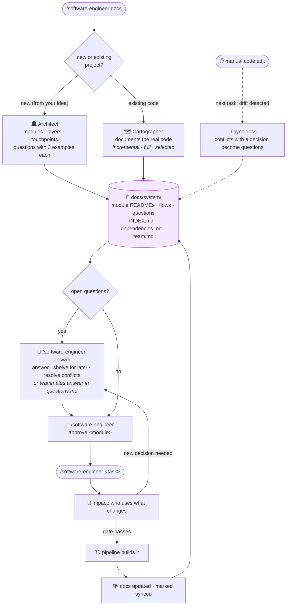
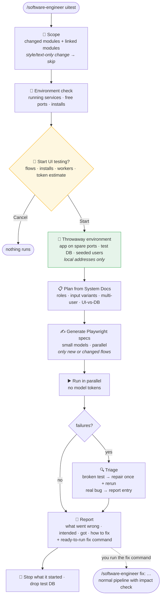
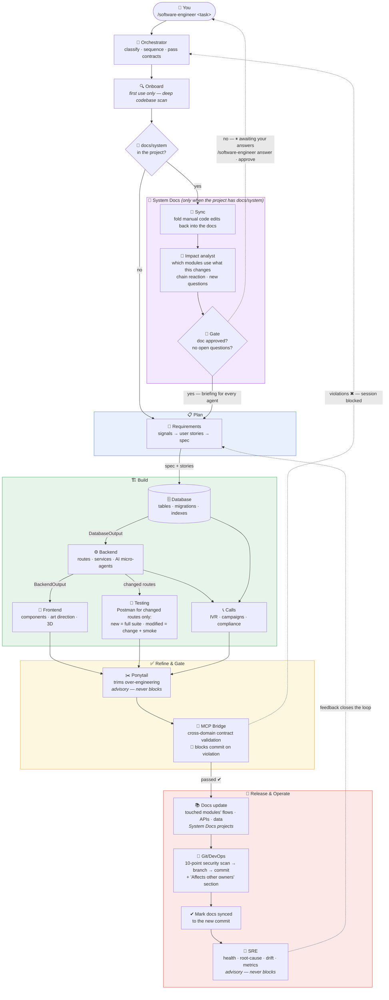
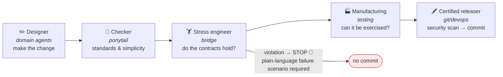
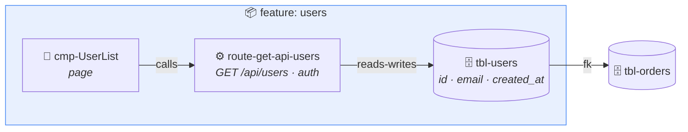
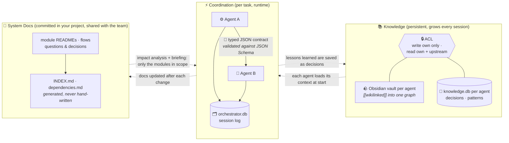

# Software Engineer

A multi-agent system that automates the full software development lifecycle — as a **Claude Code plugin** (the `/software-engineer` command) and as a **cross-IDE MCP server** (Cursor, Windsurf, VS Code, and other MCP editors).

One command. Every agent runs in sequence — requirements spec, database schema, backend routes, frontend components, Postman tests, inbound/outbound call systems, simplification pass, contract validation, security scan, git commit, and a post-release SRE review that feeds the next cycle. Each agent has its own SQLite knowledge base and Obsidian vault that grows smarter with every session.

---

## Install

In Claude Code, register this repo as a plugin marketplace, then install the plugin:

```
/plugin marketplace add MARafey/The-Software-Engineer
/plugin install software-engineer@software-engineer
```

That's it. Then run:

```
/software-engineer start
```

`start` is the one-command setup: it clones this repo to `~/.agents`, installs dependencies, seeds the knowledge bases, scans your current project, and builds its code knowledge graph — leaving you ready to build. (Running any `/software-engineer <task>` also auto-installs on first use, but `start` gets everything, including the graph, in one shot.)

> Why a plugin and not a loose file? Claude Code only loads skills that live in a folder as `skills/<name>/SKILL.md`. Dropping a single `software-engineer.md` into `~/.claude/skills/` will **not** register the slash command — the plugin packaging is what makes `/software-engineer` appear.

---

## Usage

```
/software-engineer <task>
```

```
/software-engineer add user authentication with JWT and refresh tokens
/software-engineer fix the broken /api/orders route returning 500
/software-engineer create a products table with categories and inventory
/software-engineer add a dashboard page showing sales statistics
/software-engineer generate Postman tests for all existing routes
/software-engineer add CSP and security headers to the backend
```

### All commands

| Command | What it does |
|---|---|
| `/software-engineer <task>` | Plan, build, test and commit a feature or fix. Asks clarifying questions first. In projects with System Docs, it also checks which linked features the change affects and stops for your answers before coding |
| `/software-engineer start` | One-command setup: install (if needed), scan the current project, build its code graph |
| `/software-engineer test` | Health check of the install (no files modified) |
| `/software-engineer status` | Show recent sessions |
| `/software-engineer update` | Pull the latest version |
| `/software-engineer onboard` | Re-scan the current project (runs automatically on first use) |
| `/software-engineer graph` | Build a filtered Obsidian knowledge graph of the project's real code |
| `/software-engineer docs [idea]` | Set up [System Docs](#system-docs): the project's source of truth in `docs/system/`. For a new project it plans modules and layers from your idea; for an existing one it documents the modules you choose |
| `/software-engineer answer [module]` | Go through open System Docs questions in chat |
| `/software-engineer approve <module>` | Approve a module's doc so coding on it can start (`approve layers` approves the build plan) |
| `/software-engineer team` | Map git author emails to names, shared with your team in `docs/system/team.md` |
| `/software-engineer uitest` | [UI-test](#ui-testing) the flows that changed and the flows linked to them. Shows the plan and asks before starting; never runs automatically |
| `/software-engineer uitest full` | UI-test every flow |
| `/software-engineer uitest <module>...` | UI-test the named modules' flows |
| `/software-engineer uitest --workers N` | Set how many tests run in parallel (default: half your CPU cores, max 8) |
| `/software-engineer help` | Show all commands |

---

## Other editors (Cursor, Windsurf, VS Code) — MCP server

Not on Claude Code? The same orchestrator is exposed as an MCP server, so any MCP-capable editor can use it. After the engine is set up (clone + `npm run init` — see *How it works internally*), point the editor at `node ~/.agents/mcp/server.mjs`:

```json
{
  "mcpServers": {
    "software-engineer": { "command": "node", "args": ["~/.agents/mcp/server.mjs"] }
  }
}
```

Tools: `software_engineer_health`, `software_engineer_classify`, and `software_engineer_orchestrate` (plan by default; pass `apply: true` to write files). Reasoning uses the host's model via MCP sampling, or `ANTHROPIC_API_KEY` / `OPENAI_API_KEY` when sampling isn't available — no keys are bundled. Per-editor setup in [`mcp/README.md`](mcp/README.md).

---

## Before building anything, it asks you

Before writing code, the system asks plain-language questions to remove all guesswork:

- **Frontend tasks:** What colors? Top bar or side menu? Mobile-friendly?
- **Backend tasks:** JWT auth or sessions? Rate limiting? API versioning?
- **Database tasks:** Soft delete or hard delete? UUIDs or integers? Expected data size?

For each decision, it shows you its recommendation first and asks if you agree. You can answer all questions at once or just say "use your recommendations" to accept all defaults.

If you share a mockup image or screenshot, it reads it and only asks about the parts that are unclear — not generic "what do you want?" questions.

---

## System Docs

`/software-engineer docs` creates `docs/system/` in your project: one folder per module with its flows, APIs, data examples, decisions and open questions, plus a generated index and a "who uses what" dependency map. It's committed, so your whole team shares it.

- **Before coding,** each task checks which other modules use what it's about to change, explains the chain reaction in plain language, and asks you about any decision that isn't recorded yet. Every question comes with a technical example, a plain-language example and a sample of the data.
- **Approval gate:** a module isn't coded until its doc is approved and has no open questions (`/software-engineer answer`, then `/software-engineer approve <module>`). Questions you can't answer yet can be shelved; they come back when that module is next worked on.
- **After coding,** the module docs are updated and marked in sync with the commit. Manual code edits are detected next time and folded back into the docs.
- **New projects** are planned in layers: foundation, then auth, then core data, then access control, so each layer builds on tested code below it.



Design: [`design/system-docs.md`](design/system-docs.md). A/B comparison against the plain pipeline: [`design/ab-test-report.md`](design/ab-test-report.md).

## UI testing

`/software-engineer uitest` tests the running app the way users would:

- logs in as each role and walks every flow
- tries each form field with valid, missing, wrong, boundary, unicode and special-character input
- has two users act on shared data at the same time
- checks that what the UI shows matches the database

It starts your app on spare ports with a throwaway test database, so your running services and data are never touched. Tests run only against local development addresses (`localhost`, `127.0.0.1`, `*.localhost`, `*.test`).

- **Asks first:** it shows what it will test, what it needs to install, how many tests run in parallel, and the estimated token cost, then waits for your yes.
- **Only what changed:** after a change it tests the changed flows plus the flows linked to them. Style-only or text-only changes don't trigger it.
- **Cheap to rerun:** small models write Playwright scripts once (saved in `tests/ui/`). Running them costs no model tokens, and a script is only rewritten when its flow changes.
- **Report:** `docs/system/testing/<date>-report.md` lists each bug with what went wrong, the intended result, what happened instead, how to fix it, and a ready-to-run `/software-engineer fix:` command.



Requires System Docs. Design: [`design/ui-testing.md`](design/ui-testing.md).

---

## What happens when you run a task

**First use on any project:** the system automatically scans your entire codebase before doing anything — routes, components, schema, conventions, security posture. This runs once per project and is stored in the agent knowledge bases. Every future session starts with that context already loaded.

The pipeline mirrors the full software delivery lifecycle — requirements → design → build → test → release → operate — with a feedback loop from operations back into requirements:



Frontend, Testing, and Calls run **in parallel** once the backend contract exists. Frontend-only tasks still run the frontend agent. The System Docs steps (purple, plus the docs update and sync after the bridge) only run when the project has `docs/system/`; without it the pipeline goes straight from onboarding to requirements.

Onboarding also writes a **project map**: one short note (at most 3000 characters) with the stack, folder layout, conventions, main modules, routes, tables and run commands. Every agent gets it in its prompt instead of exploring the repo again, and it is updated after each committed session with the new routes, tables and any structural changes.

For a **small task** (a bug fix or chore touching one area) the skill offers a short pipeline: it skips the separate spec, the simplification pass and the post-run review, and asks you first every time. The contract check, the security scan and the tests for changed routes always run.

The pipeline also **learns from its own catches**. When a reviewer, the contract check or the security scan has to catch the same kind of problem in two sessions on a project, it becomes a lesson that the next session's author sees up front. Lessons come only from those catches, never from opinion, stay with the project they came from, and retire once the problem stops recurring.

| Agent | Icon | Does |
|-------|------|------|
| **Impact analyst** | 🧭 | System Docs projects only. Before any code, maps the task to modules, lists every module that uses what will change and how it could break, records the chain reaction in plain language, and asks about any decision that isn't recorded. Stops for your answers if a target module's doc isn't approved |
| **Requirements** | 📝 | Runs first (spec-driven development). Synthesizes signals — your task, project logs/bug reports, last cycle's SRE feedback — into user stories with Given/When/Then acceptance criteria and a spec whose Decisions table pins every choice the other agents would otherwise guess. Undecidable items come back to you as open questions |
| **Database** | 🗄️ | Writes migration SQL, validates foreign keys, adds indexes |
| **Backend** | ⚙️ | One author plans lean data access — a single shared DB pool, disciplined AI queries (read-only, `LIMIT` + filters, no `SELECT *`), caching/lookup tables — then writes routes, controllers and services with JSDoc, following the spec; a fresh reviewer checks them against the spec and the checklists. AI/LLM features follow a full model lifecycle (traceable data, bias checks, fairness evaluation) |
| **Frontend** | 🎨 | A designer sets the art direction and UI design without writing code; an author builds the components and API wiring to it and the spec, with *layout / positioning / contrast* checklists for complex parent-child CSS; a fresh reviewer judges the whole screen, checks contrast and token/storage security, and fixes what it can. 3D tasks invoke Opus for scene/physics/shader design |
| **Testing** | 🧪 | Generates a Postman collection for what the session changed only: new routes get positive, negative and auth tests; modified routes get a test for each changed behaviour plus one smoke test; System Docs flows that call a changed route get one end-to-end scenario. Test data comes from the spec's acceptance criteria. UI testing is separate and manual (`/software-engineer uitest`) |
| **Calls** | 📞 | One author builds inbound IVR flows, outbound dialing campaigns, Twilio/Vonage webhooks and TTS scripts; an independent compliance reviewer checks TCPA/GDPR/DNC and recording consent and fixes clear gaps |
| **Ponytail** | ✂️ | The "lazy senior dev": reviews the generated code and applies behavior-preserving simplifications — never touching validation, security, or accessibility. Advisory, never blocks |
| **Bridge** | 🌉 | Validates that frontend bindings and telephony webhooks match backend contracts, and that handlers reference real tables. Any blocking violation stops the pipeline before commit |
| **Git/DevOps** | 🔐 | Runs the 10-point security scan, creates a feature branch, writes a Conventional Commit. No force-override exists by design |
| **SRE** | 📡 | Runs last (operate phase): health checks, log/root-cause diagnostics, IaC review, model-drift monitoring, and outcome metrics (coverage, violations — never lines of code). Its feedback is what Requirements reads next session |

### Release sign-off — nobody signs their own work

Borrowed from aerospace engineering: a drawing is never released by the person who drew it. Every session passes an independent chain, and each stage verifies its own discipline:



Two rules are absolute: a failed gate **blocks even under schedule pressure** (there is no force flag), and every blocking violation must explain its concrete failure scenario in plain language — a known risk poorly explained counts as a sign-off failure.

---

## Security rules (enforced before every commit)

The git agent blocks commits that contain:

- `.env` files
- Hardcoded API keys, passwords, or secrets
- Raw JWT/bearer tokens in source
- `localhost` URLs in non-test files
- Auth tokens read from `localStorage`
- Database credentials in `.js` or `.json`

---

## Knowledge bases

Each agent builds up its own Obsidian-compatible knowledge vault at `~/.agents/agents/<name>/vault/`.

```
~/.agents/agents/orchestrator/vault/  Routing, dependency order, per-task session history
~/.agents/agents/requirements/vault/  Specs, user stories, signal-synthesis playbooks
~/.agents/agents/backend/vault/       Express patterns, security rules, AI model lifecycle, route decisions
~/.agents/agents/frontend/vault/      Design tokens, storage rules, 3D scene patterns, component library
~/.agents/agents/database/vault/      Schemas, migrations, query optimization notes
~/.agents/agents/testing/vault/       Postman collections, test reports
~/.agents/agents/calls/vault/         IVR flows, campaign patterns, TTS scripts, TCPA/GDPR compliance
~/.agents/agents/ponytail/vault/      Minimal-code philosophy, review history
~/.agents/agents/gitdevops/vault/     Branch strategy, secure-by-design principles, scan results
~/.agents/agents/mcpbridge/vault/     Contract validation history, release sign-off discipline
~/.agents/agents/sre/vault/           Root-cause runbooks, drift monitoring, outcome metrics
```

## Code knowledge graph (`/software-engineer graph`)

The vaults above map the **orchestration system**. To map **your project's own code**, run `/software-engineer graph` — it parses the codebase (reusing the onboarding scan) and emits a *filtered* Obsidian graph containing only entities that actually exist in the source. Theoretical or unused nodes are deliberately excluded so the graph stays lean instead of overflowing.



Each node becomes an Obsidian note with **YAML frontmatter metadata** (file path, HTTP method, columns, auth) and `[[wikilinks]]` for every real relationship — `calls` (component → route), `reads-writes` (route → table), `fk` (table → table), and `belongs-to` (entity → feature). The output lands in `agents/orchestrator/vault/projects/<name>/graph/` (git-ignored, personal) plus a machine-readable `graph.json` for tooling. Open that vault in Obsidian and switch to Graph View to navigate your codebase as a live map.

### See the whole graph

The vaults are cross-linked with Obsidian `[[wikilinks]]`. To navigate the system as one
connected knowledge graph, **open the `~/.agents/agents/` folder itself as a single Obsidian vault**
(not an individual agent folder). You'll get:

- an **orchestrator** hub note linking to every domain agent, plus the dependency order;
- a **home note per agent** showing what it reads from (upstream), hands off to (downstream), and is validated by;
- **sub-agent** notes wired into each domain's internal pipeline (e.g. `backend-author → backend-reviewer`, with the checklists they apply linked);
- **per-task session notes** the orchestrator writes in real time as work runs.

Open Obsidian's Graph View to see the agents and their contract flow as a live map.

---

## Requirements

- [Claude Code](https://claude.ai/code) — CLI or IDE extension
- [Node.js](https://nodejs.org) 18 or later
- [Git](https://git-scm.com)
- [Obsidian](https://obsidian.md) *(optional — for browsing agent knowledge bases)*

---

## How it works internally

You install the plugin once (see above). Everything else is handled automatically:

1. First `/software-engineer` invocation → skill clones this repo to `~/.agents/`
2. `npm install` fetches `better-sqlite3`, `uuid`, `chalk`, `ajv`, `@modelcontextprotocol/sdk`
3. `node init/bootstrap.js` creates all SQLite databases and contract schemas
4. `node init/seed-vaults.js` writes the initial Obsidian vault notes
5. All future runs go straight to the orchestration workflow

### How the agents talk to each other

There are two separate layers — runtime coordination and persistent knowledge — and they never mix:



- **Coordination:** each workflow returns a typed JSON contract (`shared/contracts/*.schema.json`) that the next agent consumes — e.g. frontend binds only to routes the backend actually declared. The bridge agent blocks the git commit if any frontend↔backend or backend↔database contract is inconsistent.
- **Knowledge:** each agent owns an Obsidian vault + SQLite `knowledge.db`. Access is scoped — an agent writes only its own knowledge and reads only its own plus its upstream dependencies (the SRE and validation agents read everything). Database queries from agents are read-only and result-capped so they can't balloon context.
- **System Docs:** the project's own source of truth, kept in its repo rather than on one machine. Agents read only the index, the dependency map and the modules in scope, which keeps token use down, and update the touched modules after each change.

---

## Updating

```
/software-engineer update
```

Or manually:
```bash
cd ~/.agents && git pull origin master && npm install && node init/bootstrap.js && node init/verify.js
```

## Developer commands

Run from the repo root (`~/.agents` once installed):

| Command | What it does |
|---|---|
| `npm install` | Install dependencies |
| `npm run init` | Bootstrap databases and contracts, seed vaults, verify. Run after changing agents, contracts or seed notes |
| `npm run verify` | Health check (same as `/software-engineer test`) |
| `npm test` | Verify, plus the MCP protocol, System Docs and UI-testing CLI tests |
| `npm run test:mcp` / `test:sysdocs` / `test:uitest` | Run one test suite |
| `npm run mcp` | Start the MCP server on stdio |
| `node shared/lib/sysdocs.js <command> <project>` | System Docs CLI: `init`, `index`, `impact`, `drift`, `gate`, `approve`, `questions`, `ask`, `answer`, `defer`, `team` (see the file header) |
| `node shared/lib/uitest.js <command> <project>` | UI testing CLI: `scope`, `env`, `check-host`, `record` (see the file header) |
