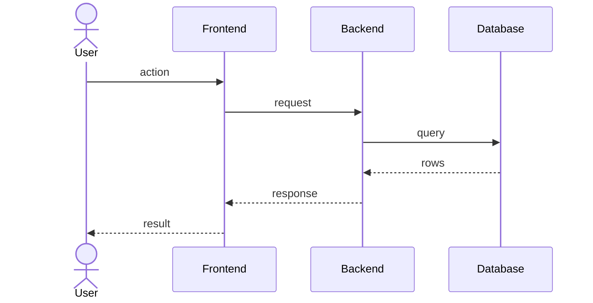

# {{module}} / {{flow}}

**Plain language:** _What the user does and what they see happen._

## Steps

1. _User action (frontend)_
2. _Request handling (backend)_
3. _Storage or third-party call (database / external API)_
4. _What comes back and what the user sees_

## Diagram

## Data at each step

_Example payloads and records as they move through the flow._

## Failure cases

- _What goes wrong, what the user sees, what the system does._
